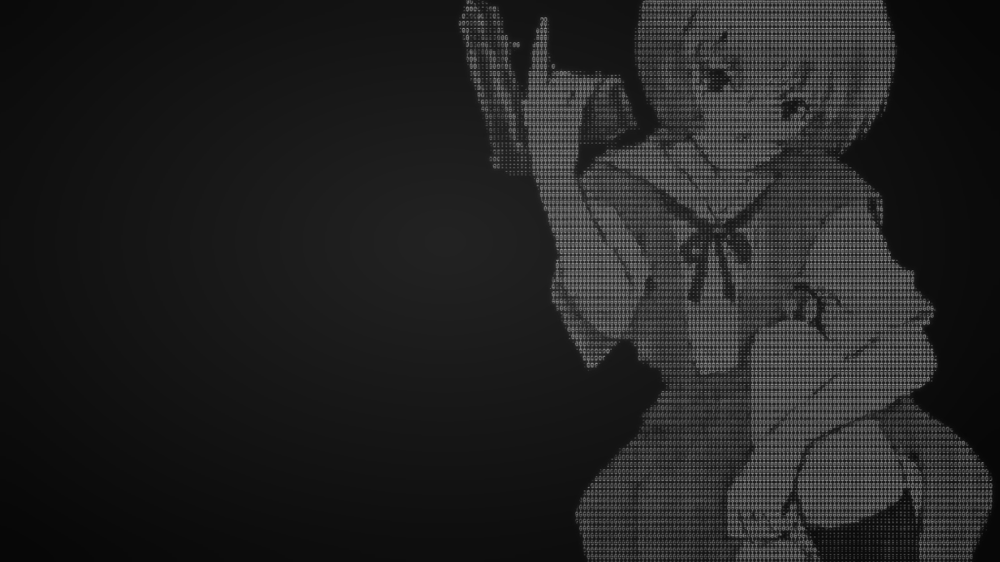

# airice

Mein KI-Rice zum Aufheben: Hyprland (Lua-Config) + Waybar im Terminal-Look, Schwarz-Weiss, ohne Transparenz.
Stand: 19.11.2026, kurz bevor ich angefangen habe, meinen eigenen Rice von Grund auf selbst zu schreiben.

Alles liegt unter `home/` genau so, wie es in meinem Home-Ordner (`~`) liegt.



## Was wo liegt

| Teil | Dateien |
|---|---|
| Hyprland (Fenster, Tasten, Animationen, Autostart) | `.config/hypr/hyprland.lua` |
| Gaming, Latenz, MangoHud (herausgeloest) | `.config/hypr/performance.lua` |
| Hintergrund-Kram (Umgebungsvariablen, polkit, Fixes) | `.config/hypr/system.lua` |
| Sperrbildschirm | `.config/hypr/hyprlock.conf` |
| Farben fuer hyprland-Tools (hyprland-run, Dialoge) | `.config/hypr/hyprtoolkit.conf` |
| Leiste oben + Infos unten | `.config/waybar/config.jsonc`, `style.css`, `scripts/` |
| App-Launcher | `.config/rofi/config.rasi`, `rice.rasi` |
| Power-Menue, Rice neu starten, Wallpaper-Generator | `.local/bin/rice-power`, `rice-reload`, `rice-wall` |
| Benachrichtigungen | `.config/swaync/config.json`, `style.css` |
| Terminal | `.config/kitty/kitty.conf`, `.local/bin/rice-shell/zsh` (fastfetch beim Start) |
| Shell und Prompt | `.zshrc`, `.config/starship.toml` |
| Kurzes fastfetch | `.config/fastfetch/rice.jsonc` (`fastfetch -c rice`) |
| GTK-Apps (Nautilus usw.) | `.config/gtk-3.0/`, `.config/gtk-4.0/`, `.gtkrc-2.0`, `.config/xsettingsd/`, Theme `.themes/Back-In-Black/` |
| Qt-Apps | `.config/qt6ct/`, `.config/Kvantum/` (Theme `MonochromeSolid`) |
| Schrift | `.config/fontconfig/` (JetBrainsMono Nerd Font als Systemschrift) |
| Dateidialoge | `.config/xdg-desktop-portal/hyprland-portals.conf` |
| MangoHud | `.config/MangoHud/` (global + pro Spiel) |
| Wallpaper | `Wallpapers/`, Auswahl ueber `.config/waypaper/config.ini` |
| Discord (Vesktop) ohne Transparenz | `.config/vesktop/` |
| Doku zum Rice (Farben, Tasten, Animationen) | `.config/rice/README.md` |

## performance.lua und system.lua

Die Teile der alten `hyprland.lua`, die nichts mit dem Aussehen zu tun haben, liegen in zwei eigenen Dateien.
Eine neue, selbst geschriebene `hyprland.lua` kann sie mit zwei Zeilen ganz oben einbinden:

```lua
require("system")
require("performance")
```

- **performance.lua**: MangoHud als globaler Vulkan-Layer, G-Sync/VRR nur im Vollbild, Tearing erlaubt,
  Direct Scanout, Maus ohne Beschleunigung, Regeln fuer Videos und DOOM, Super + Pos1 = Direct-Scanout-Check.
- **system.lua**: Cursor-Groesse, Qt/GTK-Theme-Variablen, polkit-Agent, arch-update im Tray, kleine Fixes.

Die Werte sind exakt dieselben wie in der alten `hyprland.lua` (automatisch verglichen).

## Wichtig zu wissen

- **Waybar ist nachgebaut.** Die echte Schwarz-Weiss-`config.jsonc`/`style.css` war schon geleert, als dieses Repo
  entstand. Die Dateien hier sind die letzte gesicherte Version (Rose Pine mit Pink, liegt unter
  `.config/waybar/rose-pine/`), umgefaerbt nach der Farbtabelle in `.config/rice/README.md`.
- `.zshrc` ist der Stand vom 18.11.2026.
- Nicht im Repo, weil ausserhalb von `~`:
  - `/etc/environment`: `MANGOHUD_CONFIG=read_cfg,no_display,legacy_layout=1`
  - Kontobild fuer hyprlock: `/var/lib/AccountsService/icons/viggo`
- Die alte Quickshell-Shell ("oled-bw") ist nicht hier, sondern im Repo Arch-Linux-Vault.
- Wallpaper: Rechte bei den jeweiligen Urhebern (u. a. wallhaven). Themes Back-In-Black und Monochrome: GPL-3.0, siehe LICENSE in den Ordnern.

## Pakete

hyprland, hyprlock, hyprpolkitagent, waybar, rofi, swaync, kitty, zsh, zsh-autosuggestions, zsh-syntax-highlighting,
starship, eza, fastfetch, awww, waypaper, playerctl, pavucontrol, wireplumber, jq, libnotify, grim, slurp, wl-clipboard,
brightnessctl, python-pillow, nautilus, qt6ct, kvantum, breeze-icons, xsettingsd, ttf-jetbrains-mono-nerd, mangohud,
arch-update (einige davon aus dem AUR).

## Wiederherstellen

Vorher die eigenen Configs sichern, denn das hier ueberschreibt sie:

```bash
git clone https://github.com/viggo0paal21/airice ~/airice
cp -r ~/airice/home/. ~/
```

Danach neu einloggen.
